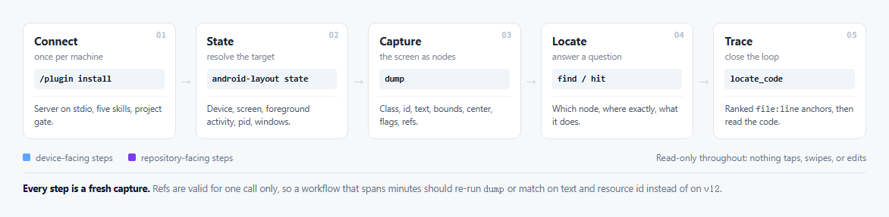
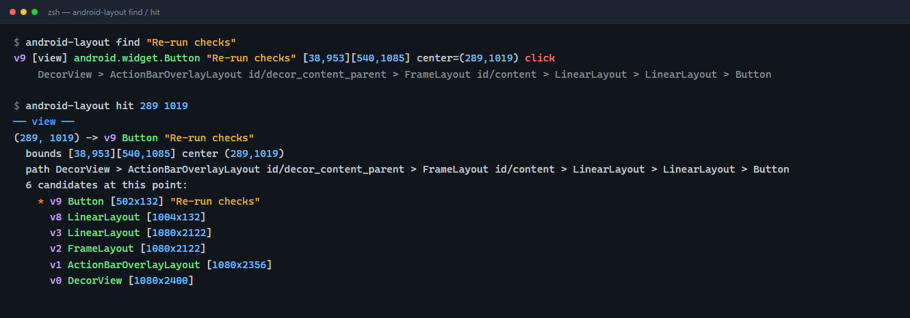

# Give Your Coding Agent a Live View of the Android Screen

#### Part 1 of two: capture, locate, and trace

*This is the first of two posts about [Android Layout MCP](https://github.com/Jayvinz/android-layout-mcp), a CLI and [MCP](https://modelcontextprotocol.io/) server that reads the live screen of a connected Android device. Part 2 follows the four capture paths and what each one costs.*


*One `dump` call. The header is where the capture explains itself; the tree is what an agent reads instead of a screenshot.*

A coding agent reads a repository well. Ask why a button is disabled and it will open the ViewModel, the state holder, the theme, and the click handler. What it cannot do on its own is look at the phone.

[Android Layout MCP](https://github.com/Jayvinz/android-layout-mcp) adds that step. It captures the current screen through [ADB](https://developer.android.com/tools/adb) and answers questions about it with structured nodes: class names, resource ids, text, bounds, centers, click and scroll flags, and, on [Compose](https://developer.android.com/develop/ui/compose) screens, the file and line of the composable behind an element. The core is exposed as a CLI and as a 9-tool MCP server, and the package ships as a Claude Code plugin with five skills, five commands, and a project gate.

By the end of this post you will have a client connected, a captured tree with device coordinates, and one visible element traced to a file and line. You will also see where the capture stops, before you build a workflow on top of it.

- 🧱 **Part 1 (this post):** connect, state, capture, locate, trace.
- 🔎 **[Part 2](https://github.com/Jayvinz/android-layout-mcp/blob/main/blog/2026-11-24-android-layout-mcp-under-the-hood.md):** what the view, accessibility, `dumpsys`, and Compose paths each return, and where they fail.



*The five stages this post walks through. Nothing here taps, swipes, or edits anything.*

### Connect a client

You need Node.js 20 or newer, `adb` on your `PATH` (or `ALM_ADB` pointing at it), a device or emulator with USB debugging enabled, and the app in the foreground. The `view` and `compose` sources also need a debuggable build; `semantics` and `dumpsys` work on any app.

In [Claude Code](https://code.claude.com/docs), the plugin install pulls in the skills, the slash commands, and the gate hook:

```text
/plugin marketplace add Jayvinz/android-layout-mcp
/plugin install android-layout@jayvinz-tools
```

The repository is both the marketplace and its first plugin. `/mcp` shows whether the server connected, and `/help` lists the commands. Restart Claude Code once, because the `PreToolUse` hook is read when a session starts.

Every other MCP client runs the same stdio server and needs only a config envelope. The CLI prints the right shape for 20 client ids:

```bash
npm install && npm run build
node dist/cli.js mcp --print-config --client cursor > .cursor/mcp.json
```

Without `--client` you get the `mcpServers` shape that Claude Code, Cursor, Cline, Windsurf, Gemini CLI, CodeBuddy, and WorkBuddy read. Redirecting stdout into a config file gives a clean result, because the destination path goes to stderr. `--serial`, `--adb`, and `--studio` are carried into the snippet when you need to pin a device.

If you would rather not add a marketplace, each release attaches a self-contained zip of about 6.4 MB with the built server and its production dependencies, which Claude Code can load directly:

```bash
claude --plugin-dir ./android-layout-mcp-0.10.0.zip
```

**Note**: every activation path first checks that the workspace is an Android project: `settings.gradle(.kts)`, `gradlew`, a module build file applying `com.android.*`, or an `AndroidManifest.xml`. In a non-Android repository the plugin activates only when you explicitly ask about a connected device screen or mention Android. A connected phone does not make a repository Android.

### Point it at a device

Two commands resolve the target the same way the MCP server does:

```bash
android-layout devices
android-layout state
```

`state` reports the model and API level, the screen size, density, and rotation, the foreground package, the Activity, the pid, and the `ViewRootImpl` windows, dialogs and popups included. Every later number, including a button center you pass to a tap command, is anchored to that target.

### Capture the screen

From a terminal, three commands cover the common cases:

```bash
android-layout dump                      # auto source, full tree
android-layout dump --settle             # wait until the UI stops animating
android-layout dump --format compact     # only nodes that say or do something
```

With no flags, `--source auto` picks per screen. XML layouts come from the debug view hierarchy, Compose screens from the accessibility tree, and mixed screens from both. `--source dumpsys` adds real View classes and ids on a release build, and `--source compose` asks the [Android Studio](https://developer.android.com/studio) Compose inspector for composable names and `file:line`.

In Claude Code you can ask for the screen in plain language; the `capture-ui` skill maps phrases such as "抓取当前页面布局" or "summarize the current screen" to `get_state` and `dump_ui`.

The text output is meant to be read:

```text
device 10.0.0.5 (Pixel 7)  android 13 (sdk 33)
screen 1080x2400 @ 440dpi (2.75x) portrait rotation=0
target com.example.spi pid=1234 activity=.MainActivity debuggable
view window: com.example.spi/.MainActivity/android.view.ViewRootImpl@60b9a5d (100ms)
v0 DecorView [0,0][1080,2400] 1080x2400 @(540,1200)
  v1 ActionBarOverlayLayout id/decor_content_parent [0,0][1080,2356] 1080x2356 @(540,1178)
    v2 FrameLayout id/content [0,234][1080,2356] 1080x2122 @(540,1295)
      v3 LinearLayout [0,234][1080,2356] 1080x2122 @(540,1295)
        v4 TextView "Android SPI · variant self-check" [38,300][1042,358] 1004x58 @(540,329)
        …   (v5-v7, three more TextView rows)
        v8 LinearLayout [38,953][1042,1085] 1004x132 @(540,1019)
          v9 Button "Re-run checks" [38,953][540,1085] 502x132 @(289,1019) {click}
```

Each line carries a ref, a class, an id or label, raw bounds, a size, a center, and flags such as `click`, `scroll`, `checked`, `disabled`, or `hidden`. JSON adds `visibleBounds` (the part that survives ancestor clipping), the parent path, and raw View properties.

Two flags are worth knowing before you trust a capture. The first is `--settle`. A snapshot taken while a list scrolls or a spinner turns describes a state that is already gone; with `--settle`, the tool samples the app's frame counter from `dumpsys gfxinfo` before capturing and waits for two quiet 250 ms intervals. The header then reads `stable: yes (settled in 814ms, 3 samples)`.

If the screen keeps animating through the budget (three seconds by default), the capture still happens and the header says `stable: no` with the frame count in the last interval. A ROM without the counter reports `stable: unknown`. JSON carries the same object as `stability`, samples included.


*The probe does not guess. It reports two quiet intervals, or a timeout, or that the counter was unavailable.*

The second is `--format compact`. Most nodes in a long tree are layout wrappers, so compact keeps the ones that carry text, a description, or an action, then promotes the children of the wrappers it drops. On the XML fixture used by the test suite, 20 nodes become 9; the payload reports `stats` (`nodes`, `kept`, `dropped`, `truncated`). `--format flat` emits the same nodes in pre-order with `depth`, so parent-child relationships stay recoverable.


*The same capture before and after pruning. Nothing that says or does anything is lost; only the scaffolding goes.*

**Note**: the human-readable tree stops at 2000 nodes. `--json` and `--out` write the complete dump, while MCP `dump_ui` caps JSON at 800 nodes and 5000 at most, so a huge screen needs `maxNodes` raised or a `savePath`.

A tree answers questions about structure. Sometimes you also want to see the boxes, which is what `shot --annotate` is for: it saves the screenshot and an SVG overlay built from the same `visibleBounds` the payload reports.


*Three answers from one capture: where the label sits, which node handles the tap, and which clickables a screen reader cannot name. A screenshot alone only shows the first.*

### Locate one element

Two commands answer "where is it" and "what is here":

```bash
android-layout find "Re-run checks" --both
android-layout hit 289 1019 --index 0
```

`find` matches text, content descriptions, resource ids, class names, and refs. `contains` ignores case, `exact` does not, and `/pattern/flags` compiles to a regular expression. `hit` returns every node under a coordinate sorted by visible area, with `--index` to step through overlapping candidates. Both skip invisible nodes by default.

Refs such as `v12` or `s43` are valid for one capture only. Every command re-captures, so a new screen means new refs; pass the id or the text when you need something stable.

Dialogs are where a single-window capture misleads: JDWP lists windows in creation order, so the window behind a translucent activity can come first. The tool compares the list with `mCurrentFocus` and captures the focused window by default. To get the rest:

```bash
android-layout dump --source view --window all
```

The text output grows one section per window; JSON returns `view.windows` with the primary marked `selected`. `find`, `hit`, and `inspect` accept the same selector, so an unfocused dialog can still be searched.



*`find` answers "which node", `hit` answers "what is under this point". The candidate list from `hit` is why the smallest element wins.*

### Trace it to source

This is the step a screenshot cannot provide. `locate_code` takes the anchors from the captured screen (text, content description, resource id, composable name or file and line, or View class) and scans the repository for ranked `file:line` candidates:

```text
/android-layout:trace-view "Re-run checks"
```

The scan returns string resources, layout definitions, `@Composable` definitions and call sites, ViewBinding usage, and click handlers, each with a score, reason, and snippet. A score of 100 marks a composable definition matched by name or line, 90 the file the Compose inspector reported, 80 an id usage next to a click listener, 78 the layout that defines the id, 48 a literal string, and 45 a call site. Test sources, `build/`, and `.gradle/` are excluded by default.


*The scores are a confidence ladder, not a popularity ranking. The definition outranks the usage, and the usage outranks a line that merely mentions the same string.*

The tool ranks files; opening them is still your job. On a different screen, a typical result points at `ProfileScreen.kt:120` for the composable, `fragment_profile.xml:34` for the layout id, and `ProfileFragment.kt:88` for the handler.

### Verify a change

Before and after a UI change, capture the same page twice and compare the dumps:

```bash
android-layout dump --json --out .alm/before.json
# rebuild, install, return to the same page and scroll position
android-layout dump --json --out .alm/after.json
android-layout analyze
```

Refs differ between captures, so match nodes on source, resource id, class, text, and path rather than on `v12` or `s43`. The two files use the same format as MCP `dump_ui(savePath=...)`, which means an agent can save the before state, make the change, save the after state, and read both.

`analyze` then runs twelve rules: small touch targets, overlapping clickables, clipped nodes, children outside a non-scrollable parent, offscreen views, invisible clickables, zero sizes, unlabeled clickables, duplicate ids, deep nesting, overdraw, and RTL mirroring gaps. Two rules need raw View properties, which the capture requests by default and lists under `skipped` for `--no-props`.

**Note**: keep `.alm/` in your `.gitignore`. Dumps contain the device serial, the package name, and the text on screen.

### The result

An agent can now answer the question that started the post. "Re-run checks" sits at `[38,953][540,1085]`, center `(289,1019)`, clickable, in a row with the equally sized "Camera module". One `find` returned the node and its parent path; one `trace-view` returned the files that mention the label.


*The whole loop in one session: capture, locate, rank, open. Every number in the final answer came from a tool result, not from the model's memory of the screen.*

### Where it stops

- `view` and `compose` need a debuggable app. Release builds fall back to `semantics` and `dumpsys`.
- JDWP usually allows one debugger per process, so attaching can fail while Android Studio is debugging.
- `compose` needs a local Android Studio, Java 17+, and API 29 or newer, takes 8 to 12 seconds per capture, and leaves a resident transport daemon that `android-layout compose-clean` removes.
- The accessibility tree only reports what the app exposes. Text drawn straight to a `Canvas`, a `SurfaceView`, or inside a `WebView` has no text or children to find.
- There is no live monitoring. Every command starts a new capture, and without `--settle` nothing tells you whether the screen was moving.
- The plugin never drives the device. There is no tap, swipe, or text input: you get evidence and coordinates, and the action stays with you.

### What's next

Android has no single API that reports the screen, so the interesting engineering is in the four paths and in merging what they return into one tree an agent can query. That is [Part 2](https://github.com/Jayvinz/android-layout-mcp/blob/main/blog/2026-11-24-android-layout-mcp-under-the-hood.md).

If you try it, start with `android-layout state` and one `dump`, and tell me which screen type broke first. The gate and the source tables are easy to extend, and reports from real apps are the only way they get better.

*The code snippets in this post use the project's MIT license:*

```text
// Copyright (c) Jayvinz. SPDX-License-Identifier: MIT
```

**Resources**

- [Repository and releases](https://github.com/Jayvinz/android-layout-mcp)
- [CLI reference](https://github.com/Jayvinz/android-layout-mcp/blob/main/docs/cli.md)
- [MCP tools and limits](https://github.com/Jayvinz/android-layout-mcp/blob/main/docs/mcp.md)
- [Data sources](https://github.com/Jayvinz/android-layout-mcp/blob/main/docs/data-sources.md)
- [Cross-agent compatibility](https://github.com/Jayvinz/android-layout-mcp/blob/main/docs/cross-agent.md)
- [Claude Code plugins](https://code.claude.com/docs/en/plugins-reference)
- [Model Context Protocol](https://modelcontextprotocol.io/)

*P.S. Thanks to everyone who ran the tool against a real app and reported the screens it could not read.*